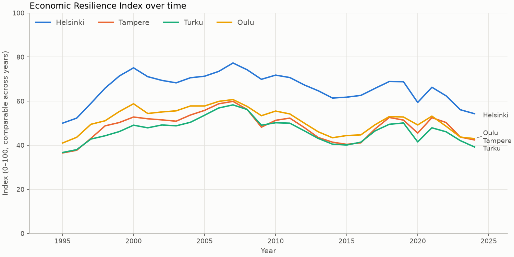
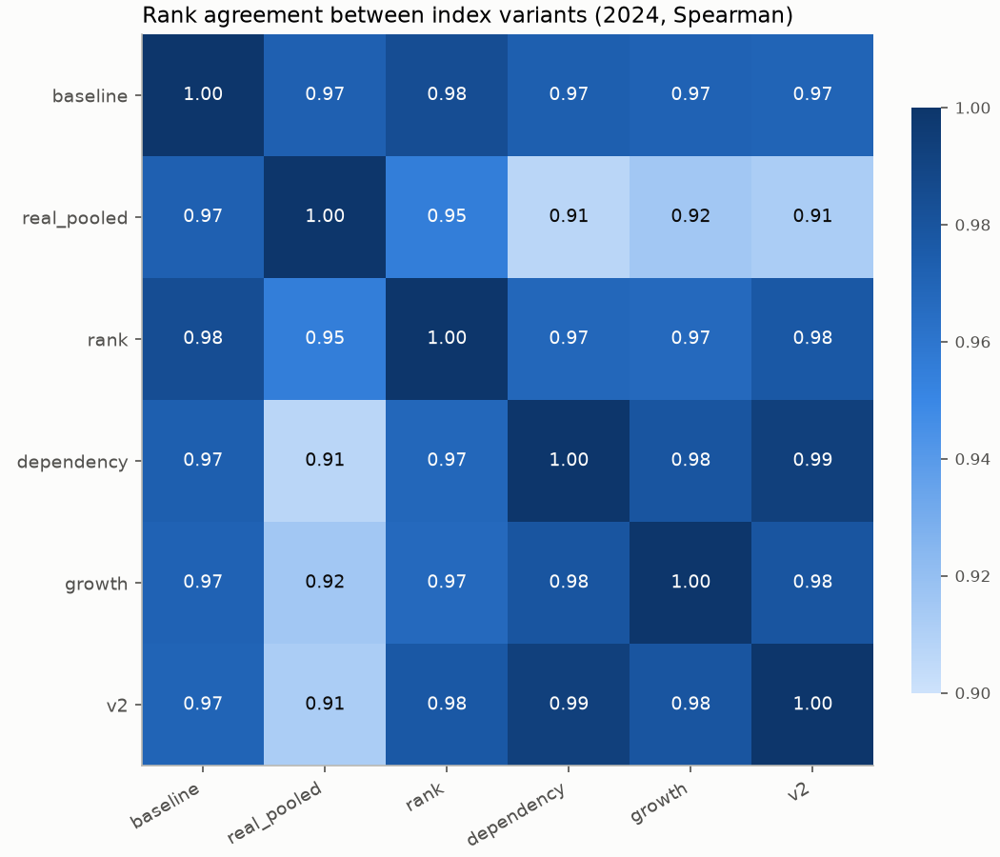
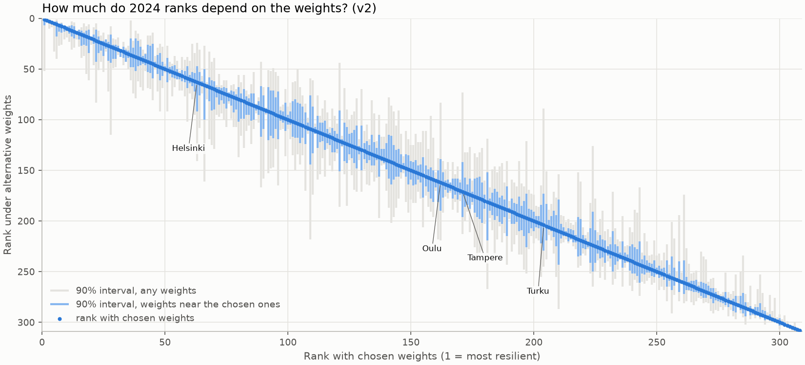
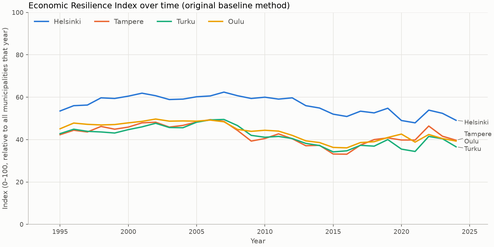
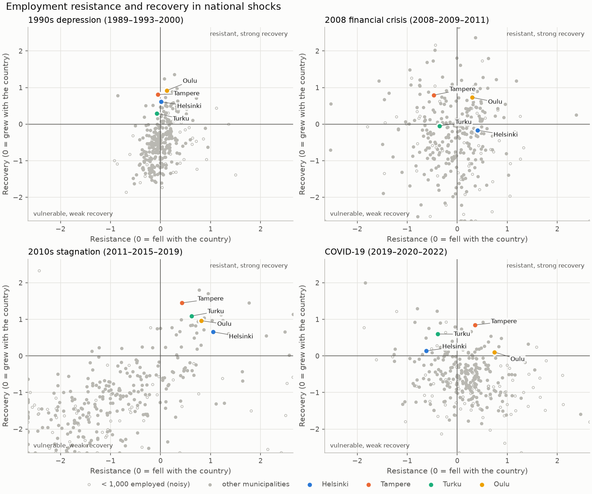

# Finnish Municipal Economic Resilience Index

A Python data pipeline that merges Statistics Finland open data for all 308 Finnish
municipalities from 1995 to 2024 and computes a composite Economic Resilience Index (0–100)
for each municipality and year. The index is comparable across years (real income, one
common scale for all years) and robust to outliers. On top of the index the project:

- compares it with five other methodological **variants**, including the original v1 method,
- tests how much the rankings depend on the **weights**, and
- measures **resistance to and recovery from** four national employment shocks
  (1990s depression, 2008 financial crisis, 2010s stagnation, COVID-19).



## Quick start

Requires [uv](https://docs.astral.sh/uv/).

```bash
uv sync                          # create .venv with locked dependencies
uv run resilience build          # the index (v2): data/raw -> results/
uv run resilience analyze        # all variants + sensitivity + shocks -> results/analysis/
uv run resilience plot Helsinki Tampere Turku Oulu
```

The raw data is committed, so everything works offline. To refresh it from the API:

```bash
uv run resilience fetch          # Statistics Finland PxWeb API -> data/raw/
```

Other commands:

```bash
uv run resilience variants                      # list the index variants
uv run resilience build --variant baseline      # original v1 method -> results/variants/baseline/
uv run resilience build --w-employment 0.4 --w-income 0.4 --w-demographic 0.2 --results-dir results/alt
uv run resilience plot Helsinki Espoo --variant baseline
uv run resilience analyze --year 2019 --draws 5000
```

## How the index works

Three components are scaled to 0–1 and combined with weights:

| Component | Indicator | Weight |
| --- | --- | --- |
| Employment score | 1 − scaled unemployment rate (18–64 year olds) | 45% |
| Income score | scaled mean gross income of household-dwelling units, in 2024 euros (CPI-deflated) | 35% |
| Demographic score | 1 − scaled economic dependency ratio (non-employed per 100 employed) | 20% |

Each indicator is turned into a robust z-score, (x − median) / (IQR / 1.349), computed over
**all municipalities and all years together**. The z-score is clipped to ±3 and mapped to
0–1. The weighted sum is multiplied by 100.

- **Comparable over time:** because one scale covers 1995–2024, a rising line is a real
  improvement, not just overtaking other municipalities.
- **Robust to outliers:** one extreme municipality (e.g. Kauniainen's income) saturates at
  1 instead of compressing everyone else.

This is the `v2` variant. Up to v0.3 the index used the `baseline` method below, which is
still built in `results/variants/baseline/` and reproduces the original hackathon results
exactly.

### Variants

`v2` is written to `results/`, every other variant to `results/variants/<name>/`.

| Variant | Scaling | Scope | Income | Demographic | What it fixes |
| --- | --- | --- | --- | --- | --- |
| `baseline` | min-max | per year | nominal | log population | – (original method) |
| `real_pooled` | min-max | pooled | real | log population | Scores are comparable **across years** |
| `rank` | percentile rank | per year | nominal | log population | Outliers (Kauniainen's income) no longer compress everyone else |
| `dependency` | min-max | per year | nominal | dependency ratio | Rewards a working-age economy rather than sheer size |
| `growth` | min-max | per year | nominal | 5-year population growth | Rewards growth rather than size |
| **`v2`** (default) | robust z | pooled | real | dependency ratio | All of the above |

- **Per-year scaling** ranks a municipality against that year's peers. It cannot show
  everyone getting better or worse together.
- **Pooled scaling** uses one scale for 1995–2024, so a rising line is a real improvement.
- **Real income** is deflated with the consumer price index to 2024 euros.
- **Robust z** is (x − median) / (IQR / 1.349), clipped to ±3 and mapped to 0–1.
- **Dependency ratio** is non-employed people per 100 employed (lower is better).

## Findings (2024 data)

**The variants broadly agree, but individual municipalities move a lot.** Rank correlations
between variants are 0.91–0.99. Still, the large cities drop when outliers and city size stop
being rewarded. Under `v2`, Helsinki falls from rank 38 to 63, Tampere from 124 to 171 and
Turku from 158 to 204. Small Åland municipalities rise.
→ `results/analysis/variant_ranks_2024.csv`



**`v2` is much less sensitive to the choice of weights.**

| | baseline | v2 |
| --- | --- | --- |
| Median 90% rank interval, small weight changes | 28 places | 15 places |
| Median 90% rank interval, any weights at all | 88 places | 42 places |
| Weight on the demographic component suggested by PCA | 1% | 39% |

In the baseline, log population is nearly unrelated to the other two components, so
data-driven weighting (PCA) would almost drop it. The dependency ratio fits with
employment and income. The method follows the uncertainty analysis in the OECD/JRC
*Handbook on Constructing Composite Indicators* (2008).
→ `results/analysis/weight_sensitivity_*.csv`



**Pooled scores show the national cycle that per-year scores hide.** The median `v2` score
rose from 37 (1995) to 59 (2007), fell to 44 by 2015, recovered to 52 (2019) and is back at
44 in 2024 (chart at the top). The same cities under the baseline method look much flatter,
because each year is scaled on its own:



**Shock resilience:** each municipality's employment is compared with the national change,
using the sensitivity index of Martin et al. (2016), *Regional Studies* 50(4):

> resistance = (local % change − national % change) / |national % change|, from peak to trough

Recovery uses the same formula from trough to recovery end. 0 means the municipality moved
with the country.

| Shock | Peak → trough → recovery end | National employment change |
| --- | --- | --- |
| 1990s depression | 1989 → 1993 → 2000 | −20.9%, then +18.7% |
| 2008 financial crisis | 2008 → 2009 → 2011 | −3.7%, then +2.8% |
| 2010s stagnation | 2011 → 2015 → 2019 | −4.2%, then +5.2% |
| COVID-19 | 2019 → 2020 → 2022 | −3.7%, then +6.1% |

Among municipalities with at least 1,000 employed people:

- **Resistant in all four shocks** (among others): Jomala, Kauniainen, Liminka, Larsmo,
  Kontiolahti, Sipoo, Vesilahti and Kempele, mostly commuter belts around growth centres
  and Åland.
- **Least resistant on average:** Hanko, Outokumpu, Urjala, Ikaalinen and Teuva, with Varkaus
  and Heinola also in the bottom ten: old industrial towns and rural municipalities.

In the 2010s stagnation, the four big cities all resisted and recovered strongly while
226 of 308 municipalities were vulnerable with a weak recovery.
→ `results/analysis/shock_resilience*.csv`



Percentage changes in municipalities with fewer than 1,000 employed people are noisy and
are flagged `Small`.

## Data

| File in `data/raw/` | StatFin table | Variable |
| --- | --- | --- |
| `gross_income.csv` | [118w](https://pxdata.stat.fi/PxWeb/pxweb/en/StatFin/StatFin__tjt/statfin_tjt_pxt_118w.px/) Income of household-dwelling units by region | 6. Gross income, mean (EUR) |
| `population.csv` | [115b](https://pxdata.stat.fi/PxWeb/pxweb/en/StatFin/StatFin__tyokay/statfin_tyokay_pxt_115b.px/) Population by area, main type of activity, sex, age | Population 31 Dec (total) |
| `employed.csv` | 115b (as above) | Population 31 Dec, main type of activity: employed |
| `unemployment_rate.csv` | [115x](https://pxdata.stat.fi/PxWeb/pxweb/en/StatFin/StatFin__tyokay/statfin_tyokay_pxt_115x.px/) Key indicators of employment statistics | Unemployment rate, 18–64, % |
| `dependency_ratio.csv` | 115x (as above) | Economic dependency ratio |
| `cpi.csv` | [11xt](https://pxdata.stat.fi/PxWeb/pxweb/en/StatFin/StatFin__khi/statfin_khi_pxt_11xt.px/) Consumer price indices, yearly | CPI 1995 = 100 (national) |

Raw files are tidy (`AreaCode, Area, Year, <value>`). Municipalities are joined on their
official code (`KU091` = Helsinki), not their name. Statistics Finland reports every year on
the current (2025) municipal division, so past mergers are already harmonised.
`data/raw/sources.json` records when each table was fetched and last updated by the publisher.

Source: Statistics Finland, StatFin database, licensed under
[CC BY 4.0](https://creativecommons.org/licenses/by/4.0/).

## Outputs

| Path | Contents |
| --- | --- |
| `results/finland_economic_resilience_index_long.csv` | The index (v2): one row per municipality-year with inputs, component scores and index |
| `results/finland_economic_resilience_index_wide.csv` | The index (v2): municipalities × years |
| `results/merge_audit_dropped_rows.csv` | Municipality-years dropped for a missing indicator, and which one |
| `results/build_summary.json` | Variant settings, coverage, dropped rows, data provenance |
| `results/variants/<name>/` | The same four files for each other variant (`baseline` = original v1 method) |
| `results/analysis/variant_ranks_<year>.csv` | Each municipality's rank under every variant |
| `results/analysis/variant_rank_correlation_<year>.csv` | Spearman matrix between variants |
| `results/analysis/weight_sensitivity_<variant>_<year>.csv` | Ranks under equal, PCA and 2,000 random weightings |
| `results/analysis/shock_resilience.csv` | Resistance and recovery per municipality and shock |
| `results/analysis/shock_resilience_summary.csv` | Per municipality, averaged across shocks |
| `results/analysis/analysis_summary.json` | The headline numbers above |
| `results/figures/` | Charts |

Currently 13 rows are dropped, all for Sottunga (population ~90), where Statistics Finland
suppresses the unemployment rate in some years.

## Project layout

```text
src/resilience/
  config.py       paths, weights, index variants, shocks, StatFin table definitions
  fetch.py        PxWeb API client (json-stat2 -> tidy CSV)
  load.py         read and validate raw tables
  transform.py    filter to municipalities, merge, audit dropped rows
  features.py     real income (CPI), population growth
  scaling.py      min-max, percentile rank, robust z; per year or pooled
  index.py        component scores and the weighted index
  sensitivity.py  weight uncertainty analysis (Dirichlet draws, PCA weights)
  shocks.py       resistance / recovery to national employment shocks
  analysis.py     `resilience analyze` orchestration
  validate.py     schema / range / uniqueness checks
  pipeline.py     end-to-end build, writes results/
  plots.py        figures (headless)
  cli.py          `resilience fetch | build | analyze | plot | variants`
tests/            pytest suite (synthetic fixtures + real-data checks)
archive/          the original hackathon script, its inputs and its results
```

## Development

```bash
uv run pytest                    # all tests (includes live API tests)
uv run pytest -m "not network"   # offline only, as in CI
uv run ruff check . && uv run ruff format .
uv run pre-commit install        # lint and format on every commit
```

CI (GitHub Actions) runs lint and the offline tests on Python 3.11 and 3.13, and checks that
the index in `results/` can be rebuilt byte-for-byte from the committed raw data.
